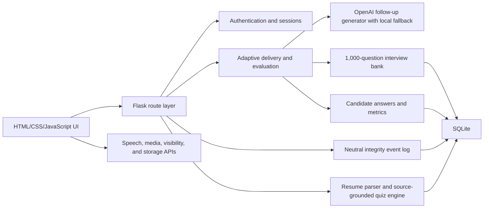

# AI Interview Simulator

> An AI-powered interview preparation platform with adaptive questioning, resume-based assessment, company-style aptitude practice, voice interaction, interview monitoring, personalized learning, and performance analytics.

AI Interview Simulator is a full-stack Flask application for realistic, adaptive interview practice. Its main page has spoken interviewer questions with company, round, domain, and difficulty controls. It also includes separate Analytics, Aptitude Quiz, Resume Quiz, and Interview Learning pages.

The adaptive engine is hybrid and explainable. It uses OpenAI for answer-aware follow-up generation when configured and automatically falls back to the local contextual engine, so no external API is required to run the project.

## Main Features

- Basic signup, login, server-side sessions, and private interview history
- Three rounds only: Technical, Manager, and HR
- 36 target companies, 18 interview domains, and Easy/Medium/Hard difficulty
- A structured 1,000-question SQLite interview bank
- Ranked, non-repetitive selection using company style, round, domain, difficulty, prior score, weak topic, progress, and question history
- Exactly five main questions with streak-based adaptive difficulty progression
- Answer-aware follow-ups generated from the previous response, performance band, missing concepts, target difficulty, and recent conversation memory
- Voice-first questions with text-to-speech, two replays, and an optional transcript
- Optional hands-free voice conversation with automatic microphone handoff, speech-end/silence detection, live transcription, auto-submit, and interviewer interruption
- Typed or spoken candidate answers with word count, pace, filler, pause, transcript-confidence, and response-time tracking
- Strict two-minute question timers with 30-second and 10-second warnings
- Camera and microphone status with optional browser-supported face-count signals
- Page visibility and window focus monitoring with neutral integrity warnings
- Detailed post-interview report on the main page
- Separate analytics history, 300-question Aptitude Quiz, and 1,200-question Interview Learning catalog
- Dedicated 200-problem Practical Coding collection with company patterns, search and combined filters, 20-item pagination, hints, brute-force and optimized approaches, completion tracking, and Python/Java/C++/JavaScript solutions
- Separate Resume Quiz with private PDF/DOCX analysis, 10 source-grounded MCQs, a 10-minute timer, answer review, readiness analytics, retakes, and history
- Responsive dark/light interface and accessible keyboard/transcript alternatives

Resume upload remains available as a legacy backend capability for compatibility, but it is not used or shown anywhere in the main interview flow.

## Resume Quiz

`/resume-quiz` is an independent resume-defense module. It never changes the main Interview Simulator configuration or question selection.

1. A private PDF or DOCX is validated and parsed into structured technical skills, professional experience, projects, education, certifications, tools, research, and achievements.
2. Contact and sensitive-personal-information lines are excluded from structured quiz evidence.
3. The generator activates questions only from detected skills connected to a resume section and stores `section`, `item`, `skill`, and source evidence for every question.
4. Each attempt contains exactly 10 unique four-option MCQs with a target distribution of 3 Easy, 5 Medium, and 2 Hard.
5. Category weighting is 4 Technical Skills, 4 Projects, and 2 Professional Experience when all three contain usable technical evidence; it adjusts without inventing missing experience.
6. A single server-authoritative 600-second deadline continues across navigation and page refreshes. Answers are autosaved, and timeout submits available answers.
7. Results provide section, skill, project, and experience analytics, risk areas, learning links, detailed explanations, source connections, history, and a progress trend.

Question generation is local and deterministic in meaning, with secure random selection and option order. It does not send resume content to an external AI service.

## Practical Coding

`Interview Learning → Practical Coding` adds 200 hands-on programming exercises without replacing the original 400-question Coding section. The bank contains 70 Easy, 90 Medium, and 40 Hard problems distributed evenly across 20 company-pattern labels. Every record includes a problem contract, constraints, valid example, progressive hint, brute-force and optimized reasoning, complexity analysis, and reference implementations in Python, Java, C++, and JavaScript.

The catalog uses the existing authenticated learning APIs and SQLite progress table. Search, company/category/difficulty filters, sorting, 20-question pagination, bookmarks, and completed state can therefore be combined and persist per user. Company labels describe interview patterns and do not claim verified question provenance.

Reseed and validate the practical catalog without removing progress for stable question IDs:

```bash
./.venv/bin/python scripts/seed_practical_coding_questions.py
```

## Question Bank

The `interview_questions` table contains exactly 1,000 unique structured questions:

| Category | Count |
|---|---:|
| Coding | 350 |
| Technical / Computer Science | 200 |
| AI / Machine Learning | 200 |
| HR / Behavioral | 150 |
| Aptitude / Logical | 100 |

Each row stores a unique ID, source catalog ID, company style, round, domain, topic, difficulty, question, ideal answer, explanation, keywords, expected points, follow-ups, estimated answer time, frequency, tags, and provenance label.

Company labels use wording such as `NVIDIA-style interview question`; the application does not claim unverified question provenance.

Rebuild the bank at any time:

```bash
./.venv/bin/python scripts/seed_interview_questions.py
```

## Adaptive Algorithm

The selector uses a weighted ranking algorithm instead of unrestricted randomness:

1. Filter by interview round and remove all question IDs already used in the session or recent browser history.
2. Rank candidates by domain relevance, requested difficulty, company style, weak-topic reinforcement, and topic rotation.
3. Add cryptographically strong random jitter so repeated setups do not produce the same sequence.
4. Score each answer for keyword coverage, relevance, completeness, structure, examples, and observable communication signals.
5. Classify each answer as Strong (`70+`), Partial (`40-69`), Wrong (`<40`), Insufficient (fewer than eight words), or Timeout.
6. Move one level higher only after two consecutive Strong answers, or one level lower after two consecutive Wrong/Insufficient/Timeout outcomes. Partial resets both streaks.
7. After a bank question, generate one contextual follow-up using the answer, matched/missed concepts, target level, and recent memory. OpenAI structured output is used when configured; invalid, unavailable, or slow provider responses fall back locally.
8. After a follow-up, rotate to a fresh unused bank topic so the five-question interview balances depth and breadth.

The selected Easy, Medium, or Hard value is the starting level. Adaptation never moves below Easy or above Hard. Follow-ups are counted within the fixed five-question interview and carry unique IDs, parent-question links, provenance, expected concepts, ideal answers, and generation reasons.

Technical scoring emphasizes correctness and completeness. Manager and HR scoring gives more weight to STAR structure, ownership, outcomes, relevance, and communication.

Detailed scores and ideal answers remain hidden during the live interview and are released only in the final report.

## Architecture



### Frontend

- `templates/index.html`: setup, system check, interview room, and report
- `static/js/main.js`: interview state machine, speech/media integration, focus monitoring, and report rendering
- `static/js/session_exit.js`: shared safe-exit controller, request cancellation, and browser navigation protection
- `static/css/styles.css`: shared responsive theme and component styles
- `templates/dashboard.html`, `aptitude.html`, `learning.html`: analytics, aptitude, and the 1,200-question learning experience
- `templates/resume_quiz.html` and `static/js/resume_quiz.js`: upload, analysis, quiz timer, review, analytics, retakes, and history

### Backend

- `interview_simulator/routes/interview.py`: setup options, sessions, answers, reports, history, and integrity events
- `interview_simulator/services/interview_delivery.py`: bank generation, ranked selection, adaptive scoring, and report aggregation
- `interview_simulator/services/ai_interviewer.py`: structured answer-aware follow-up generation, validation, memory limits, deduplication, and local fallback
- `interview_simulator/db.py`: SQLite schema and backward-compatible migrations
- `interview_simulator/services/learning.py`: learning catalog and progress
- `interview_simulator/services/practical_coding_catalog.py`: validated 200-problem Practical Coding generator and four-language reference solutions
- `interview_simulator/services/aptitude.py`: randomized aptitude engine
- `interview_simulator/services/resume_parser.py`: validated PDF/DOCX extraction and structured professional evidence
- `interview_simulator/services/resume_quiz.py`: source-grounded MCQ generation, deadline enforcement, evaluation, and analytics
- `interview_simulator/routes/resume_quiz.py`: private Resume Quiz lifecycle APIs

### Main Data Models

- `users`
- `interview_sessions`
- `interview_questions`
- `candidate_answers`
- `integrity_events`
- `aptitude_questions` and `aptitude_attempts`
- `learning_questions`, `learning_progress`, and `learning_preferences`
- `resume_analyses`, `resume_quiz_sessions`, `resume_quiz_questions`, and `resume_quiz_answers`

Detailed component boundaries and request flows are documented in [`docs/ARCHITECTURE.md`](docs/ARCHITECTURE.md). Exact selection, scoring, adaptation, randomization, resume parsing, and analytics logic is documented in [`docs/ALGORITHMS.md`](docs/ALGORITHMS.md).

## Technology Stack

- Python 3, Flask, Jinja2, Werkzeug
- SQLite with indexed queries and automatic schema migration
- HTML5, modern CSS, and vanilla JavaScript
- Web Speech API: `speechSynthesis` for interviewer audio and browser `SpeechRecognition` when supported
- OpenAI Responses API: optional structured adaptive follow-up generation; API keys remain server-side
- Media APIs: `getUserMedia` for camera/microphone and optional `FaceDetector`
- Page Visibility API, focus/blur events, `localStorage`, and `sessionStorage`
- Python `unittest`

The webcam system does not perform identity recognition. It does not infer protected attributes, personality, honesty, emotion, or mental state. Browser focus monitoring can detect that the interview page lost focus, but cannot determine which external website or application was opened.

## Repository Structure

```text
AI-Interview-Simulator/
├── app.py                         # Flask entry point
├── interview_simulator/
│   ├── routes/                    # Authentication and module APIs
│   ├── services/                  # Interview, quiz, learning, AI, and resume logic
│   ├── utils/                     # Auth, environment, and serialization helpers
│   ├── config.py                  # Environment-backed configuration
│   └── db.py                      # SQLite schema, migrations, and seed orchestration
├── templates/                     # Jinja webpages
├── static/
│   ├── css/styles.css             # Responsive shared visual system
│   └── js/                        # Module-specific browser controllers
├── scripts/                       # Reproducible question-bank seed utilities
├── tests/test_app.py              # End-to-end service and API tests
├── docs/                          # Architecture and algorithm documentation
├── uploads/.gitkeep               # Private uploads stay Git-ignored
├── .env.example
├── .gitignore
├── requirements.txt
└── USER_MANUAL.md
```

The SQLite database and all question catalogs are generated automatically on first startup. Local user records, interview history, and uploaded resume content are not committed.

## Setup

```bash
git clone https://github.com/shreyasv045/AI-Interview-Simulator.git
cd AI-Interview-Simulator
python3 -m venv .venv
source .venv/bin/activate
pip install -r requirements.txt
cp .env.example .env
python app.py
```

Open `http://127.0.0.1:5000`. If `.env` contains another `PORT`, use that port instead.

### Environment Variables

| Variable | Purpose | Example default |
|---|---|---|
| `SECRET_KEY` | Flask session signing secret | change before deployment |
| `PORT` | Local HTTP port | `5000` |
| `FLASK_DEBUG` | Development reload/debug | `0` |
| `MAX_CONTENT_LENGTH_MB` | Maximum resume upload size | `8` |
| `QUESTION_TIME_LIMIT_SECONDS` | Per-question countdown | `120` |
| `MAX_QUESTIONS_PER_SESSION` | Questions per interview (fixed by the main API) | `5` |
| `SESSION_LIFETIME_DAYS` | Login session lifetime | `7` |
| `AI_PROVIDER` | `hybrid`, `openai`, or `offline`; hybrid uses OpenAI when a key exists | `hybrid` |
| `OPENAI_API_KEY` | Optional server-side key for AI-generated follow-ups | blank |
| `OPENAI_FOLLOWUP_MODEL` | Responses API model used for structured follow-ups | `gpt-5-mini` |
| `OPENAI_TIMEOUT_SECONDS` | Maximum provider wait before local fallback | `8` |

To enable OpenAI-generated wording, set these values in `.env` and restart Flask:

```env
AI_PROVIDER=hybrid
OPENAI_API_KEY=your_api_key_here
OPENAI_FOLLOWUP_MODEL=gpt-5-mini
```

Never place `OPENAI_API_KEY` in HTML or JavaScript. If the key is absent or the provider fails, the interview continues with contextual local follow-ups.

## Use

1. Sign up or log in.
2. Review the compact performance summary.
3. Select company, round, domain, and difficulty.
4. Optionally enable `Hands-Free Voice Interview`, then read and accept the privacy notice.
5. Run the system check, or continue in typed-answer limited mode.
6. Start the interview and listen to the spoken question.
7. In manual mode, choose `Type Answer` or `Speak Answer`, then submit. In hands-free mode, the microphone opens after the interviewer and submits after a short detected silence.
8. Use `Answer Now` while the interviewer is speaking to interrupt and begin your response immediately.
9. Complete all five adaptive questions. Each response has exactly two minutes after the spoken question ends.
10. Review follow-up reasons, voice-turn analytics, scores, classifications, hidden difficulty progression, ideal answers, neutral monitoring events, and recommended Learning topics.

For a Resume Quiz, open `Resume Quiz`, upload a PDF or DOCX, review the extracted evidence, generate and start the quiz, answer ten MCQs within the single ten-minute limit, and review the source-linked analytics.

## Routes

Pages: `/`, `/dashboard`, `/aptitude`, `/learning`, `/health`

Resume Quiz page: `/resume-quiz`

Important interview APIs:

- `GET /api/interview/options`
- `POST /api/interview/start`
- `POST /api/interview/answer`
- `POST /api/interview/abandon`
- `POST /api/interview/integrity`
- `GET /api/interview/<session_id>/report`
- `GET /api/dashboard`
- `GET /api/history`

Important Resume Quiz APIs:

- `GET /api/resume-quiz/summary`
- `POST /api/resume-quiz/resume`
- `DELETE /api/resume-quiz/resume/<resume_id>`
- `POST /api/resume-quiz/generate`
- `POST /api/resume-quiz/start`
- `GET /api/resume-quiz/session/<session_id>`
- `DELETE /api/resume-quiz/session/<session_id>`
- `PATCH /api/resume-quiz/answer`
- `POST /api/resume-quiz/submit`
- `GET /api/resume-quiz/result/<session_id>`
- `GET /api/resume-quiz/history`

## Tests

```bash
./.venv/bin/python -m unittest discover -s tests -v
./.venv/bin/python -m compileall app.py interview_simulator tests scripts
```

Tests cover authentication, five-question delivery, adaptive directions and boundaries, structured AI follow-ups and fallback, timeout classification, question non-repetition, advanced voice metrics, integrity events, aptitude rotation, Learning progress, and the complete private Resume Quiz lifecycle.

## Privacy and Responsible AI

- Resume text, answers, scores, and account records are stored in the local SQLite database. The database and uploaded files are excluded from Git.
- Resume Quiz generation is local and does not send resume content to OpenAI. Only the optional adaptive interview follow-up provider receives the bounded interview context described in the source.
- Camera and microphone access is optional and controlled by browser permissions. Media is processed in the browser and is not recorded or uploaded by this application.
- Focus and face-count signals are practice cues, not evidence of misconduct. They must not be used as automated hiring or disciplinary decisions.
- Generated questions and feedback can be incomplete or wrong. A human should review feedback before using it for consequential decisions.
- Company-style preparation labels indicate practice context only; they do not imply company affiliation or official question provenance.

## Limitations

- Local answer evaluation is deterministic and keyword/structure based; it is not a trained hiring model or a validated predictor of job performance.
- OpenAI follow-up wording is optional and can vary. Provider errors deliberately fall back to local contextual rules.
- Browser speech recognition availability and accuracy depend on the browser, network, microphone, accent, and environment.
- PDF/DOCX extraction works best with text-based, clearly sectioned resumes. Scanned PDFs require OCR, which is not implemented.
- `FaceDetector` support is browser dependent, and its face-count output can be imperfect. No face recognition or emotion inference is performed.
- SQLite and the built-in Flask server are suitable for local development, not a horizontally scaled production deployment.

## Academic Relevance

This project demonstrates an explainable adaptive system, rule-based NLP feature extraction, human-AI voice interaction, safe external-model fallback, randomized assessment design, information retrieval from structured question banks, privacy-aware monitoring, analytics aggregation, and full-stack software engineering. The design intentionally separates deterministic algorithms from optional generative-AI behavior so results remain reproducible without an API key.

## Roadmap

- Evaluate semantic scoring methods against a human-rated answer dataset.
- Add multilingual speech and interview content with language-specific evaluation.
- Introduce opt-in encrypted storage and configurable data-retention controls.
- Add production deployment profiles for PostgreSQL, WSGI serving, and managed secrets.
- Build longitudinal personalized learning recommendations from weak-topic history.
- Add OCR for scanned resumes and broader document-format support.

## Screenshots

Screenshots are not committed yet. Add reviewed, non-sensitive interface captures under `docs/screenshots/` before publishing them in this section.

## Contributing

See [`CONTRIBUTING.md`](CONTRIBUTING.md) for the development workflow and validation requirements.

## License

No open-source license has been selected. Copyright remains with the project owner unless a license is added explicitly.

## Troubleshooting

### Camera is denied

Allow the site in browser permissions and run System Check again. The interview remains usable with typed answers and an optional question transcript when the camera or speech output is unavailable.

### AI follow-ups show local fallback

This is expected when no OpenAI key is configured. To enable model-generated wording, add `OPENAI_API_KEY` and `AI_PROVIDER=hybrid` to `.env`, then restart Flask. Invalid output, provider errors, and timeouts intentionally fall back instead of stopping an interview.

### PDF upload says `pypdf` is missing

The main interview no longer uses resumes, but the legacy upload API still requires all dependencies:

```bash
source .venv/bin/activate
pip install -r requirements.txt
```

### Resume Quiz cannot read a file

Use a valid text-based `.pdf` or `.docx` file. Scanned-image PDFs require OCR and are intentionally rejected instead of producing generic questions. Password-protected PDFs are unsupported.

### Port already in use

Set another port in `.env`, restart the app, and open that URL:

```env
PORT=5050
```

### Question bank is unavailable

Rebuild it and restart Flask:

```bash
./.venv/bin/python scripts/seed_interview_questions.py
```

## Production Note

Flask's built-in server is for development. For continuous or public hosting, use a production WSGI server, a strong `SECRET_KEY`, HTTPS, secure cookie settings, managed database backups, an explicit retention policy for interview data, and an appropriate deployment platform.

See `USER_MANUAL.md` for the extended step-by-step guide.
