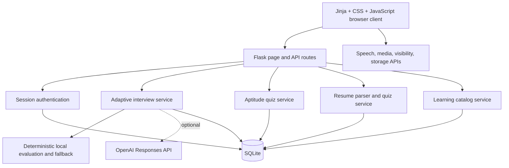
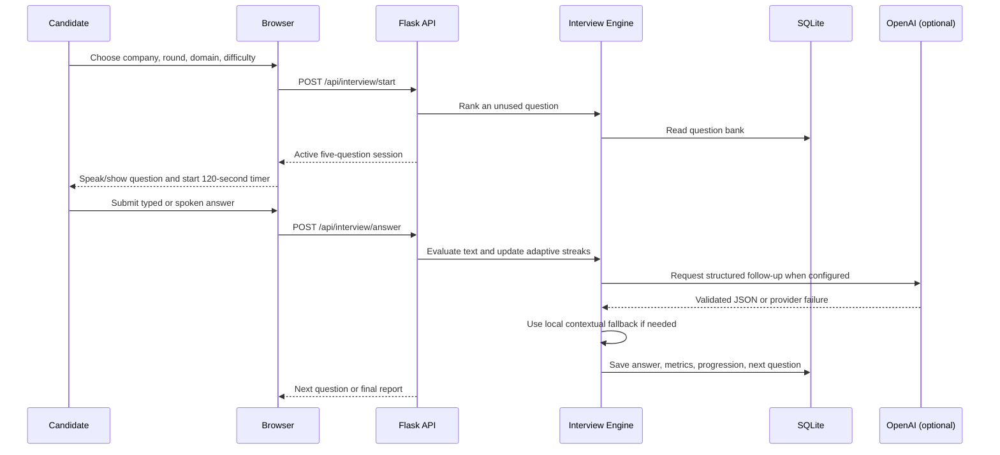

# System Architecture

## Overview

AI Interview Simulator is a server-rendered Flask application with five independent browser modules: Main Interview, Analytics, Aptitude Quiz, Resume Quiz, and Interview Learning. Flask serves Jinja templates and JSON APIs from one process. SQLite stores authenticated user state, generated question banks, attempts, responses, and analytics.

## Runtime Layers

| Layer | Implementation | Responsibility |
|---|---|---|
| Presentation | Jinja, HTML5, CSS, vanilla JavaScript | Responsive views, forms, timers, charts, question navigation |
| Browser integration | Web Speech, MediaDevices, FaceDetector when available, Page Visibility | Spoken interaction and optional practice-room signals |
| API | Flask blueprints | Authentication, authorization, validation, lifecycle endpoints |
| Domain services | Python service modules | Selection, evaluation, adaptation, resume analysis, quiz generation, statistics |
| Optional generative AI | OpenAI Responses API | Structured answer-aware follow-up wording only |
| Persistence | SQLite | Users, sessions, question banks, answers, progress, analytics |

## Main Interview Flow

The browser uses an explicit state machine for question preparation, interviewer speech, answer capture, timeout, processing, and completion. A shared exit controller aborts in-flight requests and cleans timers, speech, camera, microphone, face checks, and temporary session state when the candidate leaves.

## Module Boundaries

### Main Interview

- `routes/interview.py` owns API authorization and persistence.
- `services/interview_delivery.py` owns question ranking, scoring, adaptation, and report aggregation.
- `services/ai_interviewer.py` owns bounded OpenAI prompting, strict schema validation, deduplication, and fallback generation.
- `static/js/main.js` owns the browser interview state machine and device lifecycle.

### Aptitude Quiz

- A 300-question company-style bank is generated reproducibly and stored in SQLite.
- Each active attempt receives ten unique randomized questions and shuffled answer positions.
- Results and company/category statistics are created only on explicit submission or timeout.

### Resume Quiz

- PDF and DOCX parsing occurs on the Flask server.
- Structured evidence is extracted locally; contact-like lines are excluded from quiz evidence.
- Questions are generated only from detected skills connected to projects, experience, or skill sections.
- Active quiz questions and autosaved answers are isolated from the original uploaded resume record.

### Interview Learning

- The catalog provides 1,000 aptitude, coding, and interview study entries.
- Server-side filters, pagination, progress, bookmarks, notes, confidence, and revision state are user-scoped.

## Data and Security Boundaries

- Passwords are hashed with Werkzeug and never stored as plaintext.
- Flask sessions use an environment-backed signing key and HTTP-only, SameSite cookies.
- SQL values are parameterized; user-owned resources are filtered by authenticated user ID.
- The OpenAI key remains server-side. Resume content is not sent to the optional provider.
- Local `.env`, SQLite databases, uploaded files, and caches are Git-ignored.
- Camera and microphone streams stay in the browser and are stopped on exit; the app does not save recordings.

## Production Considerations

The current deployment target is local development. A public deployment should replace the Flask development server, move from SQLite to a managed database, configure HTTPS and secure cookies, use managed secrets, define data retention/deletion policies, add rate limiting and CSRF protection where appropriate, and perform a formal privacy/security review.
